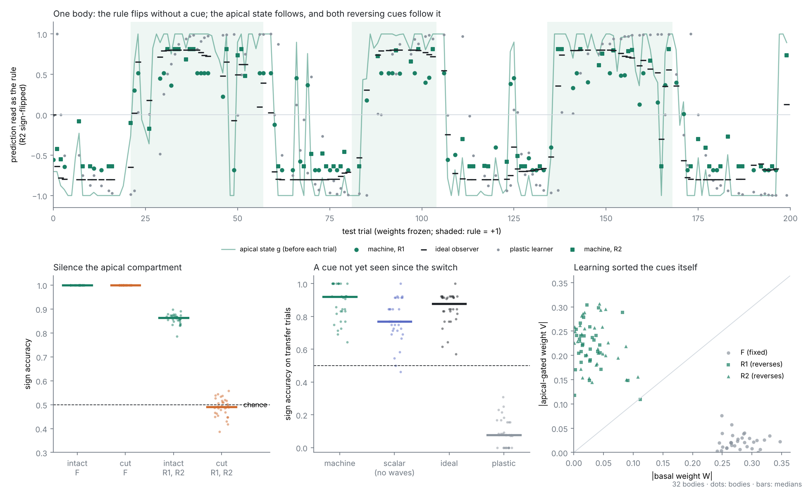

# Apical Rule-Reversal Machine

**A wave body whose dendrites can multiply.** It learns by itself which cues reverse with a hidden rule. It infers the rule from its own surprise, with its weights frozen. It carries the inference to a cue it hasn't seen since the rule changed. When its apical compartment is silenced, it loses exactly the reversing cues, as Zhang et al. report for mouse cortex. All five rules set before the run held. The waves themselves add nothing to the computation: a no-wave copy of the same algorithm is more accurate.

Antti Luode's direction · Claude Opus 5.5, design, code and write-up · 17 November 2026. It follows [WaveComputer](https://github.com/anttiluode/WaveComputer)'s [REAL_THING.md](https://github.com/anttiluode/WaveComputer/blob/main/REAL_THING.md).

[Protocol, committed before the batch](PROTOCOL.md) · [machine](wavecomputer/rulemachine.py) · [world and baselines](experiments/ruleworld.py) · [receipt](experiments/results.json) · [summary](experiments/summary.json)



## Why

WaveComputer's field only **adds**. For two ±1 signals, every function is $`c_0 + c_1 A + c_2 b + c_3\,A b`$. Its worlds were symmetric, so the interaction term $`c_3`$ was never needed, and an adding field was enough.

Zhang et al. (2025) put mice on a task that **is** that term. The meaning of some tones flips with a hidden rule; other tones keep their meaning. In L5 pyramidal neurons the rule shows up in the apical dendrites, the tone at the soma, and the two combine nonlinearly. Inhibiting the dendrites degraded choices for the reversing tones more than for the fixed ones. The mice get no cue when the rule changes. They have to notice it from their own mistakes.

## The machine

WaveComputer's verified engine (impulse-response wave field, fade clocks, damping-branch timing), with one new compartment:

| | |
|---|---|
| **cues** | F, R1, R2, each with its own receptor and 12 fade clocks that fire 24–60 ticks after it |
| **outcome** | B = ±1, a wave at site 4. The prediction field must cancel it at sites 3–5 |
| **branch** | two weights: basal **W** and apical-gated **V**. Write = pulse · (**W + g·V**) |
| **apical state g** | one value in [−1, 1], shared by every tuft: a single context signal |

**Learning** extends the damping rule to three factors. After a unit fires, each branch averages what its tip hears, `acc = prediction − world`:
- `W ← W − k·acc`, as before;
- `V ← V − k·g·acc`: the same error, times the context when the unit fired;
- once per trial, `g ← g − η·Σ(acc·V) / (s·(ΣV² + κ))`. The context moves to the value that would have silenced the tips.

**Weights are slow and the state is fast.** Weights learn only during 1500 training trials, at a fifth of WaveComputer's rate. g moves on every trial where an outcome is seen. Nothing tells any unit which cue reverses, or when the rule changes.

**The world:**
- F always gives +1;
- R1 gives +rule, R2 gives −rule;
- each outcome is flipped with probability 0.1;
- the rule flips with no cue, after 20–40 trials.

## Results

32 bodies, seeds 400001–400032, test of 400 fresh trials per body with **weights frozen**. Medians.

| Rule set beforehand | Required | Measured | |
|---|---|---|---|
| **S1** learning sorts the cues: F into W, R1 and R2 into V | ≥ 29/32 | **31/32** | pass |
| **C1** the cut: g silenced | R at chance, F ≥ 0.95, R size ≤ 0.2 and F size ≥ 0.9 of intact | R **0.49**, F **1.00**; size R **0.10**, F **1.00** | pass |
| **I1** infers the rule: R sign accuracy | ≥ 0.80 | **0.86** (ideal 0.92) | pass |
| **T1** transfer: a reversing cue not yet seen since the switch | machine ≥ 0.75, plastic ≤ 0.25, machine above in ≥ 29/32 | machine **0.92**, plastic **0.08**; **32/32** | pass |
| **B1** closer to the ideal observer than the plastic learner | ≥ 29/32 | error 0.105 vs 0.242; **32/32** | pass |

The one body that missed S1 (400026) is a tie on R1 (|W| = |V| = 0.11), and it still infers the rule (0.87) and transfers (0.85).

**All of them side by side** (about 13 transfer trials per body):

| | R accuracy | F accuracy | error vs ideal | transfer trials |
|---|---:|---:|---:|---:|
| ideal observer (knows everything) | 0.92 | 1.00 | 0 | 0.88 |
| **machine** | 0.86 | 1.00 | 0.105 | **0.92** |
| scalar copy, no waves | 0.87 | 1.00 | **0.069** | 0.77 |
| plastic learner, per cue | 0.82 | 0.92 | 0.242 | 0.08 |
| machine, apical cut | 0.49 | 1.00 | 0.333 | 0.50 |

## What it shows

1. **One multiplying compartment is enough to learn a rule from surprise.** The weights sorted themselves. A cue whose outcome never depends on the context ends up in W, because its V averages to zero over contexts. A cue that flips ends up in V, because its W averages to zero. No unit was labelled.
2. **Inference is state, not weights.** With every weight frozen, the machine follows uncued reversals. The plastic learner can follow them only by relearning each cue, so it misses the first trial of every cue after a switch (0.08 there). It also lets noisy outcomes shake F (0.92).
3. **The cut reproduces the mouse pattern, more cleanly than the mice.** Silencing g leaves the fixed cue untouched (1.00) and drops both reversing cues to chance. In the mice the reversing choices were degraded, not abolished. Here learning separates the cues completely, so the cut is all-or-none. That's a property of the toy, not a better match to biology.
4. **The machine reacts faster than is ideal.** On transfer trials it beats the ideal observer (0.92 against 0.88), because its apical state jumps after one or two surprises. It pays for that elsewhere: its overall accuracy is lower (0.86 against 0.92), because a single noisy outcome also moves g.
5. **The waves don't compute any of this.** The scalar copy — the same algorithm with one number per cue and no waves — is closer to the ideal in 32 of 32 bodies. The waves carry the gate's product through time, through fade clocks and an impulse-response field. The computation is the multiplication and the three-factor rule. I predicted this before the run, and it holds.

## Ledger

**Shown:** S1, C1, I1, T1 and B1, pre-registered, in one batch.

**How we got here (disclosed in the protocol):** two designs failed in development before this one.
- The first had an unnormalized apical step: transfer was at chance, because a cue with a small gated weight barely informed g.
- The second had fast weights: W followed every block on its own and competed with inferring the rule.
- The apical rate was chosen on six development bodies.

**Supplied, not learned:**
- the cue receptors (identity is given);
- the shared apical state, and its sign at the start (+1);
- the normalized step and κ;
- the learning rates;
- the block structure (only the ideal observer knows it).

**Known:**
- context-dependent gating in networks;
- three-factor plasticity;
- normalized LMS;
- hidden-state inference (the ideal observer here is an exact filter over rule and block position);
- apical amplification (Larkum; Marvan & Phillips).

**Ours:**
- these, on fade clocks writing an impulse-response wave field, with local branch rules;
- the cut test mirroring Zhang et al.;
- the transfer test;
- the finding that slow weights are needed for the latent rule to be learned at all.

**Not shown:**
- that waves help: they do not, here;
- more than one rule, or rules that are not simple sign flips;
- a context state that is learned rather than given as one shared value;
- graded (not all-or-none) cut effects, as in the mouse.

## Run

```sh
python -m pip install numpy matplotlib
python tests/test_engine.py        # with the apical compartment off, the machine equals WaveComputer's verified branches
python experiments/dev.py          # development bodies (3 minutes)
python experiments/run.py          # the batch, 32 bodies (6 minutes on two cores)
python experiments/analyze.py      # summary.json against PROTOCOL.md
python experiments/figure.py
```

## Lineage and sources

- [WaveComputer](https://github.com/anttiluode/WaveComputer): the verified engine (vendored nodes, impulse-response field). Its [REAL_THING.md](https://github.com/anttiluode/WaveComputer/blob/main/REAL_THING.md) proposed this test.
- [WaveComputerAstra](https://github.com/anttiluode/WaveComputerAstra): the rule to keep a scalar baseline beside every wave result.
- [QualiaClaude](https://github.com/anttiluode/QualiaClaude) and [QualeX](https://github.com/anttiluode/QualeX).
- Y. Zhang et al., "Dendritic computation for rule-based flexible categorization", bioRxiv (2025), doi:10.1101/2025.06.03.657766. A preprint, not peer reviewed.
- T. Marvan and W. A. Phillips, *Current Research in Neurobiology* 6 (2024) 100129.

MIT licence.
